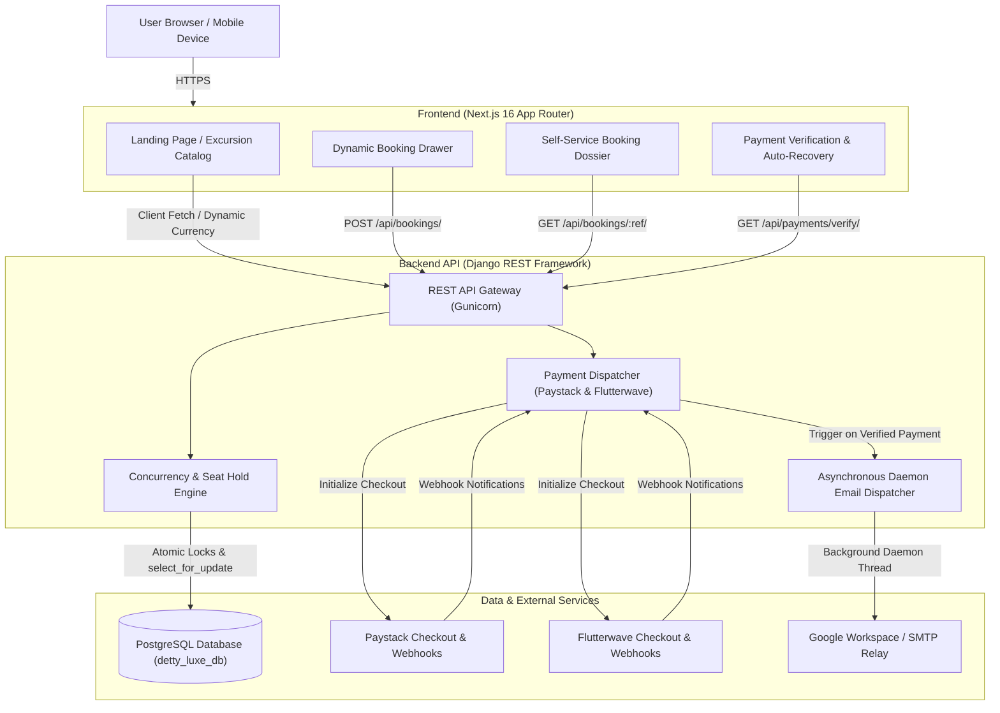

# Detty December Lagos Luxe 🌴✨
### High-End Curated Tourism & Excursion Platform for Lagos Festive Season

[](https://nextjs.org/)
[](https://react.dev/)
[](https://www.djangoproject.com/)
[](https://www.django-rest-framework.org/)
[](https://www.postgresql.org/)
[](https://caprover.com/)
[](#)

> **Detty December Lagos Luxe** is an end-to-end luxury travel booking platform built collaboratively by **Incel Holidays and Tourism** and **Prospiz Management Consulting**. Designed specifically for high-net-worth Nigerian diaspora and international travelers returning to Lagos for the festive season, the platform delivers zero-friction reservations, real-time multi-currency checkout (NGN, USD, GBP), vetted private security, and luxury excursion management.

---

## 🏛️ System Architecture

The application is architected as a decoupled, high-performance monorepo with an **API backend** powering a modern **Next.js frontend**:



---

## ✨ Key Features & Capabilities

### 1. Curated Luxury Excursions & Packages
- **8 Distinct Lagos Luxe Offerings**: Ranging from private island beach clubs (Tarkwa Bay) and canopy skywalks to Fela Kuti Afrobeat cultural immersions, coastal Badagry heritage, fine dining, and VIP nightlife table experiences.
- **Dynamic Inclusions & Schedule Highlights**: Each excursion presents structured itineraries, meeting locations, private security details, and transparent inclusions.

### 2. Multi-Currency Pricing (NGN, USD, GBP)
- Real-time client currency toggling across all packages and booking drawers.
- Strict dual-tier rate management: local resident pricing vs. non-resident international visitor rates.
- Conversion tracking preserves the currency chosen at checkout alongside the exact converted total.

### 3. Concurrency Protection & Automatic Seat Holds
- **Atomic Database Locks**: Prevents race conditions during peak booking windows using `select_for_update()` and `transaction.atomic()`.
- **Seat Hold Lifespan**: Reserving a package temporarily holds inventory (`held_seats`) for **30 minutes** (`BOOKING_HOLD_TIMEOUT_MINUTES`).
- **Auto-Expiration**: If a checkout is abandoned, held seats are automatically released back into inventory without administrative overhead.

### 4. Dual Payment Gateway Integration
- **Paystack**: Seamless card and instant bank transfers with HMAC-SHA512 webhook signature verification.
- **Flutterwave**: Global card processing, Mobile Money, and USSD support with secret hash verification.
- **Pending Session Recovery**: If a customer navigates away or accidentally closes their browser on the gateway screen, a persistent banner and lookup tool allow resuming checkout without restarting the booking.

### 5. Asynchronous Transactional Email Engine
- Built with zero dependency on Redis or Celery, using non-blocking background daemon threads.
- **Customer Confirmation**: Elegant branded HTML ticket with booking reference, full itinerary breakdown, lead guest information, financial audit, and calendar directions.
- **Internal Operations Alert**: Instant notification to the operations and logistics desk (`info@inceltourism.com`) with a one-click direct WhatsApp contact button and public dossier link.
- **Dynamic Local/Prod Switching**: Prints readable multipart text directly to the console during local development and connects to live SMTP relay in production.

---

## 📁 Repository Structure

```text
incel_prospiz/
├── api/                         # Django REST Framework Backend
│   ├── config/                  # Django project configuration & WSGI/ASGI
│   │   ├── settings.py          # Production-hardened settings with runtime audit
│   │   ├── urls.py              # Root API URL routing
│   │   └── wsgi.py              # WSGI entrypoint for Gunicorn
│   ├── core/                    # Core business application
│   │   ├── emails/              # Transactional email services & configuration
│   │   ├── management/commands/ # Seed and maintenance management commands
│   │   ├── migrations/          # Schema migrations for PostgreSQL
│   │   ├── templates/emails/    # Responsive HTML email templates
│   │   ├── tests/               # 96 unit, integration, and concurrency tests
│   │   ├── models.py            # Package, Booking, Inclusions, Promo models
│   │   ├── payments.py          # Paystack & Flutterwave gateway clients
│   │   ├── serializers.py       # DRF serializers with input validation
│   │   ├── urls.py              # Core API endpoints
│   │   └── views.py             # Viewsets, booking workflow, and webhook handlers
│   ├── populate_packages.py     # Seed script for initial 8 packages & promo codes
│   ├── requirements.txt         # Python dependencies
│   └── manage.py                # Django CLI tool
│
├── frontend/                    # Next.js 16 App Router Frontend
│   ├── app/                     # App router pages & layouts
│   │   ├── booking/lookup/      # Self-service public booking dossier
│   │   ├── booking/verify/      # Payment return handler & polling verification
│   │   ├── globals.css          # Design system, CSS variables & typography
│   │   ├── layout.tsx           # Global HTML shell & metadata
│   │   └── page.tsx             # Main luxury landing page & catalog
│   ├── components/              # Modular UI components
│   │   ├── BookingModal.tsx     # Responsive booking modal & mobile drawer
│   │   ├── ExperiencePillars.tsx# Trust markers & service standard pillars
│   │   ├── Hero.tsx             # High-impact luxury hero section
│   │   ├── ItineraryTimeline.tsx# Detailed day-by-day festival schedule
│   │   ├── Navbar.tsx           # Sticky navigation with currency switcher
│   │   ├── PackageSelector.tsx  # Interactive package grid with filters
│   │   ├── PendingCheckoutNotifier.tsx # Persistent checkout recovery banner
│   │   └── UrgencyTicker.tsx    # Live inventory and scarcity beacon
│   ├── data/                    # Client data & package specifications
│   │   └── packages.ts          # Package interfaces, metadata, and ground truth
│   ├── lib/                     # API communication client
│   │   └── api.ts               # Type-safe API methods & error handling
│   ├── public/images/           # High-resolution optimized travel assets
│   ├── package.json             # NPM dependencies & build scripts
│   └── tsconfig.json            # TypeScript configuration
│
├── .gitignore                   # Multi-tier ignore rules (Secrets, IDE, artifacts)
├── AGENTS.md                    # Pair-programming instructions & guidelines
├── DESIGN.md                    # Impeccable design system tokens & specification
└── README.md                    # Root project documentation (this file)
```

---

## 🚀 Quickstart Guide (Local Development)

### Prerequisites
- **Python 3.12+**
- **Node.js 20+** and **npm**
- **PostgreSQL 14+** (running locally or in a container)

---

### Step 1: Backend Setup (Django)

1. Navigate to the `api` directory:
   ```bash
   cd api
   ```

2. Create and activate a Python virtual environment:
   ```bash
   python3 -m venv venv
   source venv/bin/activate
   ```

3. Install required dependencies:
   ```bash
   pip install --upgrade pip
   pip install -r requirements.txt
   ```

4. Configure your local environment file:
   ```bash
   cp .env.example .env
   ```
   *(Ensure `DB_NAME`, `DB_USER`, and `DB_PASSWORD` point to your local PostgreSQL instance).*

5. Apply database migrations:
   ```bash
   python manage.py migrate
   ```

6. Seed initial packages, itineraries, and promo codes:
   ```bash
   python populate_packages.py
   ```

7. Start the local API server:
   ```bash
   python manage.py runserver 127.0.0.1:8000
   ```
   The API will be available at `http://127.0.0.1:8000/api/`.

---

### Step 2: Frontend Setup (Next.js)

1. Open a new terminal and navigate to the `frontend` directory:
   ```bash
   cd frontend
   ```

2. Install dependencies:
   ```bash
   npm install
   ```

3. Configure your local environment file:
   ```bash
   cp .env.example .env.local
   ```
   *(Defaults to `NEXT_PUBLIC_API_URL=http://127.0.0.1:8000/api`)*.

4. Start the Next.js development server:
   ```bash
   npm run dev
   ```
   The web application will be accessible at `http://localhost:3000`.

---

## 🧪 Testing & Verification

The backend includes a comprehensive test suite of **96 automated unit and integration tests** covering models, edge cases, bundle discounts, seat holds, payment gateways, webhooks, and email dispatch.

To run the backend test suite:
```bash
cd api
source venv/bin/activate
python manage.py test
```

To run a frontend build check and linter:
```bash
cd frontend
npm run lint
npm run build
```

---

## 🚢 Production Deployment (CapRover Architecture)

The project is designed for deployment on an existing **CapRover** production server with custom subdomains on **`inceltourism.com`**:

### CapRover Apps Setup
| Component | CapRover App Name | Internal Port | Production Domain |
|---|---|---|---|
| **Backend API** | `detty-luxe-api` | `8000` | `https://api.inceltourism.com` |
| **Frontend UI** | `detty-luxe-frontend` | `3000` | `https://detty.inceltourism.com` *(or inceltourism.com)* |
| **Database** | `srv-captain--<postgres-app>` | `5432` | Internal CapRover network |

### Automated GitHub Actions CI/CD (`main` branch)
Deployments are automated through `.github/workflows/ci-cd.yml` on push to `main`:
1. **Automated Verification**: Runs Django checks, unit test suite, and frontend build tests.
2. **Container Build**: Builds multi-stage Docker images for both API and Frontend with `NEXT_PUBLIC_API_URL=https://api.inceltourism.com/api` baked into the frontend bundle.
3. **Registry Publish**: Publishes versioned images to GitHub Container Registry (`ghcr.io`).
4. **CapRover Webhook Trigger**: Automatically informs CapRover to pull the latest images and redeploy containers with zero downtime.

---

## 🔒 Security & Environment Hardening

When running with `DJANGO_DEBUG=False`, the application automatically validates the environment upon startup:
- **Secret Key Verification**: Insecure default or short secret keys immediately halt server execution.
- **Allowed Hosts**: Wildcard `*` entries are strictly forbidden in production; explicit subdomains are enforced.
- **Database Credentials**: PostgreSQL password and host cannot be empty.
- **CORS & CSRF**: Only trusted frontend origins (`https://detty.inceltourism.com`) are allowed cross-origin access.
- **Webhook Signatures**: Incoming webhooks from Paystack and Flutterwave reject any payload lacking valid cryptographic HMAC / Secret Hash signatures.

---

## 📞 Support & Operations

- **Operator**: Incel Holidays and Tourism & Prospiz Management Consulting
- **Official Inquiries**: [info@inceltourism.com](mailto:info@inceltourism.com)
- **Technical Lead**: Samuel Iwelumo ([samueliwelumo@incelgroup.com](mailto:samueliwelumo@incelgroup.com))
- **Headquarters**: Lagos, Nigeria
