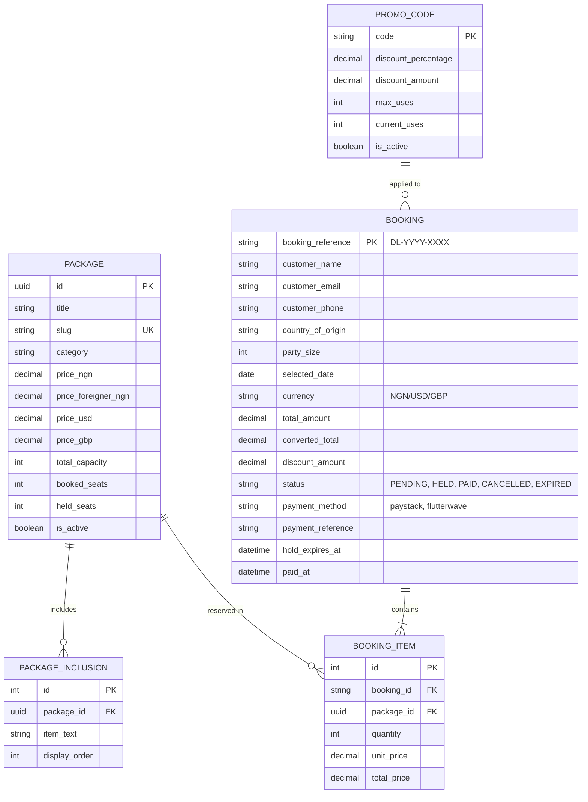
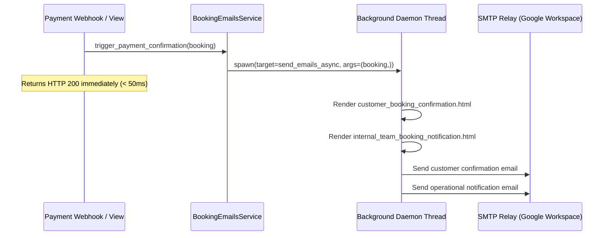

# Detty December Lagos Luxe — Backend API Engine ⚙️

Django 6.1 & Django REST Framework backend service providing high-reliability booking reservations, seat inventory holds, multi-gateway payments (Paystack & Flutterwave), and asynchronous transactional email notifications.

---

## 🏗️ Architecture & Core Components

```text
api/
├── config/                  # Django project root
│   ├── settings.py          # Production security audits, CORS/CSRF, dynamic email backend
│   ├── urls.py              # Root routing table
│   └── wsgi.py              # WSGI server entrypoint
├── core/
│   ├── emails/              # Transactional email subsystem
│   │   ├── config.py        # Centralized sender metadata, subjects, recipient lists
│   │   └── services/
│   │       ├── base.py      # Daemon thread asynchronous dispatcher & renderer
│   │       └── booking_emails.py # Customer & internal operations email orchestrators
│   ├── management/commands/ # Django administrative CLI commands
│   │   ├── expire_stale_bookings.py # Garbage-collects expired holds
│   │   └── test_booking_email.py    # Sandbox email delivery tester
│   ├── migrations/          # PostgreSQL schema migration history
│   ├── templates/emails/    # Cross-client responsive HTML email templates
│   ├── tests/               # 96 unit & integration test cases
│   ├── models.py            # Data models: Package, Booking, Inclusions, PromoCode
│   ├── payments.py          # Paystack & Flutterwave API integrations
│   ├── serializers.py       # DRF serialization & input validation
│   ├── urls.py              # REST API endpoint declarations
│   └── views.py             # ViewSets, checkout coordinator, webhook listeners
├── populate_packages.py     # Idempotent package catalog & promo code seed script
├── requirements.txt         # Pinned production dependencies
└── manage.py                # Django CLI tool
```

---

## 🗄️ Data Models & Entity Relationships



---

## 🔌 API Reference & Endpoints

### 1. Catalog & Campaign Analytics

| Method | Endpoint | Description |
|---|---|---|
| `GET` | `/api/packages/` | List all active packages with live seat availability counters |
| `GET` | `/api/packages/{slug}/` | Retrieve full package details, inclusions, and itinerary highlights |
| `GET` | `/api/stats/` | Public campaign metrics (total inventory, booked seats, scarcity beacons) |

---

### 2. Promotional Code Validation

#### `POST /api/promo/validate/`
Validates voucher codes (`EARLYBIRD5`, `DETTY5`, `VIPLAGOS`) against date validity, active flags, and usage quotas.

**Request Payload:**
```json
{
  "code": "EARLYBIRD5",
  "subtotal": 150000
}
```

**Response (200 OK):**
```json
{
  "valid": true,
  "code": "EARLYBIRD5",
  "discount_percentage": "5.00",
  "discount_amount": 7500.00,
  "final_total": 142500.00
}
```

---

### 3. Booking Workflow & Concurrency Engine

#### `POST /api/bookings/`
Creates a provisional booking and places an atomic hold on inventory for 30 minutes.

**Request Payload:**
```json
{
  "customer_name": "Samuel Iwelumo",
  "customer_email": "samuel@example.com",
  "customer_phone": "+2348012345678",
  "country_of_origin": "UK",
  "party_size": 2,
  "selected_date": "2026-12-24",
  "package_ids": ["3fa85f64-5717-4562-b3fc-2c963f66afa6"],
  "currency": "NGN",
  "promo_code": "EARLYBIRD5",
  "special_requests": "Window table preference",
  "payment_method": "paystack"
}
```

**Response (201 Created):**
```json
{
  "booking_reference": "DL-2026-8492",
  "status": "HELD",
  "hold_expires_at": "2026-10-21T09:30:00Z",
  "total_amount": 142500.00,
  "currency": "NGN",
  "checkout_url": "https://checkout.paystack.com/0a9f8b...",
  "payment_method": "paystack"
}
```

---

### 4. Self-Service Booking Lookup & Dossier

#### `GET /api/bookings/{booking_reference}/`
Retrieves the complete public booking dossier for a guest or operations coordinator.

**Response (200 OK):**
```json
{
  "booking_reference": "DL-2026-8492",
  "status": "PAID",
  "customer_name": "Samuel Iwelumo",
  "customer_email": "samuel@example.com",
  "party_size": 2,
  "selected_date": "2026-12-24",
  "packages": [
    {
      "title": "Badagry Slave Route & Coastal Heritage Tour",
      "category": "excursion",
      "duration": "Full Day (7:30 AM – 5:30 PM)",
      "location": "Badagry Coastal District"
    }
  ],
  "financial_audit": {
    "total_received": "142,500 NGN",
    "payment_gateway": "Paystack",
    "paid_at": "2026-10-21T09:05:12Z"
  }
}
```

---

### 5. Payment Webhooks & Verification

| Method | Endpoint | Verification Mechanism |
|---|---|---|
| `POST` | `/api/payments/paystack/webhook/` | HMAC-SHA512 verification against `HTTP_X_PAYSTACK_SIGNATURE` |
| `POST` | `/api/payments/flutterwave/webhook/` | Secret hash verification against `HTTP_VERIF_HASH` |
| `GET` | `/api/payments/verify/?reference={ref}` | Direct server-to-server gateway verification query |
| `POST` | `/api/payments/checkout-session/` | Re-generates a fresh gateway checkout session for an active hold |

---

## 🔒 Concurrency & Seat Hold Engine

During peak festive booking rush, multiple users may attempt to reserve the final seats on a package simultaneously. The booking coordinator mitigates race conditions through **pessimistic row-level locking**:

```python
with transaction.atomic():
    # Lock package rows in database until transaction completes
    packages = Package.objects.select_for_update().filter(id__in=package_ids)
    
    for pkg in packages:
        available = pkg.total_capacity - (pkg.booked_seats + pkg.held_seats)
        if available < party_size:
            raise ValidationError(f"Insufficient capacity on {pkg.title}. Only {available} seats remaining.")
        
        # Atomically increment temporary held count
        pkg.held_seats += party_size
        pkg.save(update_fields=['held_seats'])
```

- Seats remain in `held_seats` until payment is confirmed or hold timeout elapses.
- Once payment confirms, `held_seats` is decremented and `booked_seats` is incremented.
- If payment fails or times out, `held_seats` is restored automatically.

---

## 📧 Transactional Email Subsystem

The email architecture delivers high-priority transactional notifications with zero impact on HTTP request latency:



### Dynamic Backend Switching
- **Local Development**: `EMAIL_BACKEND = 'django.core.mail.backends.console.EmailBackend'`. All emails print cleanly to the terminal logs with full multipart bodies.
- **Production**: `EMAIL_BACKEND = 'django.core.mail.backends.smtp.EmailBackend'`. Authenticates with `smtp-relay.gmail.com` over TLS.

---

## 🛠️ Management Commands

```bash
# 1. Populate initial 8 packages, structured inclusions, and promo vouchers
python populate_packages.py

# 2. Sweep and release expired booking holds
python manage.py expire_stale_bookings

# 3. Test email rendering and delivery for a specific booking reference
python manage.py test_booking_email --reference DL-2026-8492 --recipient test@example.com
```

---

## 🧪 Automated Test Suite (96 Tests)

Run the comprehensive test suite:
```bash
python manage.py test
```

### Test Coverage Highlights:
- `test_models.py`: Capacity calculation constraints, slug generation, promo code usage logic.
- `test_packages_api.py`: Catalog listing, category filtering, public inventory masking.
- `test_booking_creation_api.py`: Payload validation, multi-package cart subtotals, group discounts.
- `test_bundle_and_capacity_concurrency.py`: Concurrency race condition simulation with atomic transactions.
- `test_seat_hold_and_expiry.py`: Timeout expiry verification, hold release, garbage collection sweep.
- `test_payment_integration.py`: Paystack & Flutterwave checkout initialization and webhook verification.
- `test_email_notifications.py`: Customer and operational email generation, template rendering, and error isolation.
- `test_edge_cases_and_validation.py`: Invalid phone formats, future dates, currency mismatch protection.

---

## ⚙️ Environment Variables Reference

```dotenv
# General Django Settings
DJANGO_DEBUG=False
DJANGO_SECRET_KEY=minimum-50-character-cryptographically-random-string
DJANGO_ALLOWED_HOSTS=api.inceltourism.com,srv-captain--detty-luxe-api
FRONTEND_BASE_URL=https://detty.inceltourism.com
CORS_ALLOWED_ORIGINS=https://detty.inceltourism.com

# Database Connection (PostgreSQL)
DB_NAME=detty_luxe_db
DB_USER=your_postgres_user
DB_PASSWORD=your_postgres_password
DB_HOST=srv-captain--incel-portal-postgres
DB_PORT=5432

# Booking Configuration
BOOKING_HOLD_TIMEOUT_MINUTES=30

# Paystack Gateway
PAYSTACK_PUBLIC_KEY=pk_live_...
PAYSTACK_SECRET_KEY=sk_live_...

# Flutterwave Gateway
FLUTTERWAVE_PUBLIC_KEY=FLWPUBK_...
FLUTTERWAVE_SECRET_KEY=FLWSECK_...
FLUTTERWAVE_ENCRYPTION=FLWSECK_...
FLUTTERWAVE_SECRET_HASH=your_webhook_secret_hash

# Transactional Email Settings
EMAIL_HOST=smtp-relay.gmail.com
EMAIL_PORT=587
EMAIL_USE_TLS=True
EMAIL_USE_SSL=False
EMAIL_HOST_USER=info@inceltourism.com
EMAIL_HOST_PASSWORD=your_app_specific_password
DEFAULT_FROM_EMAIL=info@inceltourism.com
EMAIL_SENDER_NAME=Incel Holidays and Tourism
EMAIL_ENABLED=True
EMAIL_DEBUG=False
INTERNAL_NOTIFICATION_EMAILS=info@inceltourism.com,samueliwelumo@incelgroup.com
```
